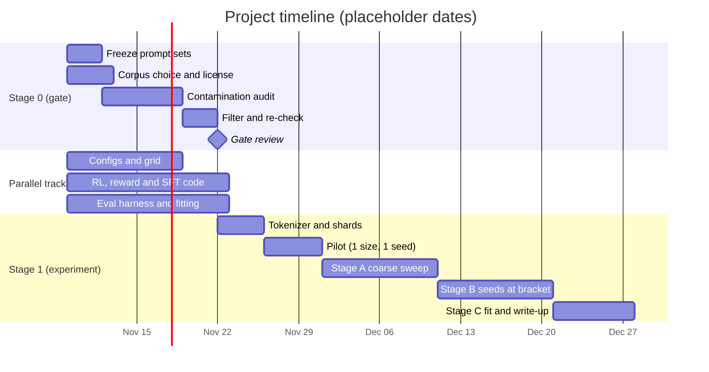

# Smallest reasoning-capable model under RL: experiment protocol (draft v4)

2026-11-02 · asked by arush

A draft protocol for finding N*, the smallest model size at which RL on a verifiable arithmetic task gives a reliable pass@1 gain, at Chinchilla-style token budgets. It is a living document: the setup and parameters will change, so each change should be recorded here with its date. Items marked [done] are settled, [open] still need a decision, and [speculative] marks my own estimates. Dates in section 15 are placeholders.

The project runs in two stages. Stage 0 is a data audit that gates everything that depends on the corpus. Stage 1 is the experiment. A parallel track builds the non-data parts during Stage 0.

# Stage 0: data audit (gate)

## 0.1 Freeze the prompt sets [open]
- Freeze the held-out eval puzzles, SFT prompts and RL prompts. Record their hashes in the audit report.
- Any change to a frozen set after the audit means the audit must be re-run.

## 0.2 Corpus choice and license [open]
- Primary candidate: HuggingFaceTB/smollm-corpus, subset fineweb-edu-dedup (about 220B tokens). Verify its license on the dataset card before download.
- Fallback or robustness corpus: mlfoundations/dclm-baseline-1.0. Its card says research use only; check before use.
- Record the dataset name, revision and subset in the protocol.
- Note: an educational quality filter can shift the pretraining floor and therefore N*. The corpus choice is part of the result and must be recorded.

## 0.3 Contamination audit [open]
- Level 1 (mandatory): verbatim overlap between the corpus and the frozen prompt sets, using 13-gram hashes after normalization. Any hit is removed.
- Level 2: task-template phrasing (e.g. "Using the numbers ... equal ..."). Report counts. Decide the threshold for action in the pilot.
- Level 3: arithmetic density (documents with many explicit equations). Report counts. Math-heavy web text is normal, so this is a review signal, not automatic removal.
- Audit results are counts and document IDs only. Matched text is not copied into the repo.
- Known limit: n-gram matching does not catch paraphrases.

## 0.4 Filter and re-check [open]
- Remove level-1 hits before shuffling and sharding. Otherwise the nested prefixes change and the shard checksums break.
- Re-run level 1 on the final stream and confirm zero hits.

## Stage 0 deliverables and gate
- Frozen prompt hashes.
- Audit report: counts per level, corpus name, revision, subset, date.
- Removed document IDs (kept out of the repo unless the group decides otherwise).
- Gate passes when: zero level-1 hits in the final stream, and the level-2 and level-3 decisions are recorded before any shard is built.

## Parallel track (runs during Stage 0)
- Model configs for the grid (section 4).
- SFT and RL code, reward function, and the Countdown generator.
- Eval harness, verdict criterion (section 6), bootstrap and curve-fitting code.
- Pilot scripts for the checklist in section 11.

# Stage 1: experiment (starts when the gate passes)

## 1. Question
At Chinchilla-optimal pretraining, what is the smallest model size N* at which RL on a verifiable task gives a reliable gain in pass@1? Below N*, RL should leave the policy at the zero-reward floor, or give gains within noise.

## 2. Hypothesis (falsifiable)
The verdict is monotone in size: once RL works at N, it works at every larger N in the grid. If the verdict flips back and forth, N* is undefined and we report the flip pattern.

## 3. Data [partly done]
- [done] Split first: carve out the held-out test set and eval probes before anything else. (Part of Stage 0 freeze.)
- [done] Tokenizer: trained on the train split only, after Stage 0. Vocabulary fixed across all sizes. [open] Size: small (about 8k to 16k) for natural text, to keep the embedding cost low.
- [done] Dedupe: document-level, including near-duplicates, before sharding.
- [done] Shuffle and interleave: global shuffle with a logged seed. With multiple sources, interleave at fixed weights so every prefix has the same mix.
- [done] Nested shards: one tokenized stream in shuffled order. Model i reads the first T_i tokens. Shards are flat uint16 binaries, with an end-of-document token between documents.
- [open] Coverage: the corpus must hold at least T_max = 20 * N_max tokens. For a grid up to N = 1B, that is 20B tokens, about 40 GB of uint16 storage. If the corpus is smaller, cut the grid or gather more, because repeated data breaks the assumptions here.
- [open] Per-prefix checks: token counts per source, length histograms, and loss of a fixed probe model on each prefix.

## 4. Model grid [partly done]
- [done] Architecture: dense decoder, pre-norm RMSNorm, RoPE, SwiGLU, grouped-query attention, tied embeddings. Fixed across sizes.
- [done] Size definition: N = non-embedding parameters. Embedding size is fixed across the grid, so it cannot drive the threshold.
- [done] Token budget: T_i = 20 * N_i. Shard i = first T_i tokens of the stream.
- [open] Grid: 8 log-spaced sizes, e.g. 5M, 10M, 20M, 50M, 100M, 200M, 500M, 1B. Vary width at roughly fixed depth-to-width ratio (d/L about 64 to 128), one knob at a time. [speculative] The ratio is a heuristic, not a law.

## 5. Task and pipeline [open items marked]
- Task: Countdown-style arithmetic, binary reward. SFT and RL data are generated separately from the pretraining corpus, so the shard scheme does not apply to them.
- SFT: synthetic reasoning traces from a fixed proposal policy, the same for all sizes.
- RL: GRPO, fixed step budget and learning-rate schedule, same prompt set for all sizes. [open] Step count.
- Eval: pass@1 and pass@8 on at least 1,500 held-out puzzles, disjoint from SFT and RL data. Bins B1 to B4 for eval, B5 held out for analysis.

## 6. Verdict criterion (pre-register before any run) [open]
Reasoning is present at N if the RL-minus-SFT pass@1 gain is at least delta, with a 95% bootstrap CI excluding 0. Starting guess for delta: 2 points. The RL checkpoint's pass@1 must also be above the zero-reward floor on at least B2.

N* = the smallest N in the grid where the verdict is "present" and every larger N is also "present".

## 7. Search
- Stage A: all sizes, 1 seed. Mark the first flip.
- Stage B: 3 to 5 seeds at the bracketing sizes, narrowing until the bracket is adjacent grid points.
- Stage C: fit gain vs. log N over all runs; report N* with fit uncertainty.

If Stage B and Stage C disagree, report both.

## 8. Controls
- Second shuffle seed at 2 to 3 sizes near the threshold, to check that a lucky prefix is not setting the result.
- Second token budget (5 * N) to see how N* moves with data.
- Second test distribution (B4 only, or multiplication) to check that N* is not specific to Countdown.
- Second corpus (e.g. DCLM-baseline) at 2 to 3 sizes, if Stage 0 allows it.

## 9. Compute [speculative estimate]
- Pretraining is cheap for small N. For N = 1B and T = 20B, 6ND gives about 1.2e20 FLOPs.
- RL dominates. The chess paper (arXiv:2607.16097) reports about 160 H200 GPU-hours for 2,000 RL steps on a 50M model. Larger models cost more per step.
- First pass: 8 sizes at 1 seed, then 3 to 5 seeds at 2 to 3 bracketing sizes. That is roughly 20 to 30 RL runs. Run a pilot to check real cost before committing.
- [proposed, see section 14] Pretrain once per size and branch the RL seeds from that checkpoint. This would cut pretraining to one run per size.

## 10. Division of work [open]
- Stage 0: prompt freeze, corpus check, contamination audit, filtering. One owner.
- Parallel track: configs, RL and reward code, eval harness, verdict and fitting code. Split between the others.
- Stage 1: tokenizer and shards, pretraining runs, SFT, RL, eval, write-up.

Everyone reviews sections 6 and 7 before any run.

## 11. Pilot checklist
- Data: shard i equals the first T_i tokens of the stream (checksum). Per-prefix mix checks pass. Test set is disjoint from all training data.
- One size, one seed, end to end. The RL reward is not all zeros. If it is, the task is too hard at that size and the curriculum needs to be easier.
- Eval noise: re-run one checkpoint with a different eval seed.
- Level-2 and level-3 thresholds from section 0.3 are set and recorded.

## 12. What would change our minds
- The verdict flips more than once across the grid: monotonicity fails, so report the flip pattern.
- Gains are present at every size, including the smallest: the floor is below the grid, so extend it downward.
- Gains are absent at every size: the task is too hard, not the model too small.

## 13. Limitations
Countdown is not natural language, so a small-model result does not transfer automatically to math or general reasoning. The grid and seed count are small, so the threshold is coarse. The contamination audit catches verbatim overlap, not paraphrase.

## 14. Engineering settings [open, proposed]
These are implementation choices. Settings marked "exact" should not change results, up to floating-point noise. Settings marked "model change" change the model, so they are ablations, not defaults. Every setting that changes numerics must be the same across the whole grid.

Exact (proposed as defaults):
- Mixed precision bf16, with fp32 for loss and optimizer states. Same for all sizes.
- FlashAttention for attention.
- Sequence packing with proper attention masking.
- Gradient accumulation to hit the target batch size.
- Gradient checkpointing only if memory requires it.
- Memory-mapped shards with prefetch and pinned memory.
- Fused optimizer and norm kernels, checked once against the reference on a few batches.
- Vocabulary size and hidden dimensions as multiples of 64, chosen at config time.

Numerics-changing (choose once, apply to whole grid, record in changelog):
- torch.compile or CUDA graphs. Small models are often launch-bound, so this can help a lot.
- Deterministic kernels, if affordable. Full determinism can cost speed.

Experiment-structure savings (proposed):
- Pretrain once per size. Branch SFT and RL seeds from that checkpoint, so only RL seeds vary. Check this does not hide variance we need for the verdict.
- Cache SFT traces and held-out eval outputs.
- Use vLLM or a similar engine for RL rollouts.
- Checkpoint often, so preempted runs resume.
- Stop dead RL runs early only under a pre-registered rule, for example zero reward for N consecutive steps.

Ablation arms (model changes, not defaults):
- Activation shift from Peng, Zheng and Liu (arXiv:2610.14500, 2026). The shift subtracts a constant b inside the MLP. Because the down-projection W2 trains, this is not a fixed bias that can be folded away in advance, so it must be implemented directly. How b is set for SwiGLU is undefined in the paper as I read it, so this arm is blocked until that is decided.

## 15. Timeline [placeholder dates]
The dates below are placeholders to show the shape of the plan. Shift them once the group agrees on a start date and on the durations. Stage 0 and the parallel track run together. Stage 1 starts only after the gate.

Text version (weeks from start, placeholder):
- Weeks 1 to 2: Stage 0 audit, parallel track building.
- Week 2 to 3: gate review.
- Weeks 3 to 4: tokenizer, shards, pilot.
- Weeks 5 to 6: Stage A coarse sweep.
- Weeks 7 to 8: Stage B seeds at the bracket.
- Weeks 9 to 10: Stage C fit and write-up.

## Changelog
- v4 (2026-11-02): split into Stage 0 (data audit gate) and Stage 1 (experiment), with a parallel track; added section 15 (timeline, placeholder dates); second corpus added to controls.
- v3 (2026-11-02): added section 14 (engineering settings), and the checkpoint-sharing proposal in section 9.
- v2 (2026-11-02): added data-side decisions (split, tokenizer, dedupe, nested shards, coverage), non-embedding N, and fixed token budget T = 20N.

## Sources
- Understanding Reasoning from Pretraining to Post-Training, arXiv:2607.16097 (2026). https://arxiv.org/abs/2607.16097
- Rethinking Activation Functions: Reducing Bias Can Improve Learning, Peng, Zheng and Liu, arXiv:2610.14500 (2026). https://arxiv.org/abs/2610.14500
- Scaling Behaviors of LLM RL Post-Training, arXiv:2509.25300 (2025). https://arxiv.org/abs/2509.25300
- A Technical Study into Small Reasoning Language Models, arXiv:2506.13404 (2025). https://arxiv.org/abs/2506.13404
- Small Models Struggle to Learn from Strong Reasoners, arXiv:2502.12143 (2025). https://arxiv.org/abs/2502.12143
- TinyZero, Jiayi Pan (2025). https://github.com/Jiayi-Pan/TinyZero
- Does Reinforcement Learning Really Incentivize Reasoning Capacity in LLMs Beyond the Base Model? (Yue et al., NeurIPS 2025). https://neurips.cc/virtual/2025/poster/119944
- Training Compute-Optimal Large Language Models (Hoffmann et al., NeurIPS 2022). https://proceedings.neurips.cc/paper/2022/file/c1e2faff6f588870935f114ebe04a3e5-Paper-Conference.pdf
- SmolLM-Corpus, HuggingFaceTB (Hugging Face dataset card). https://huggingface.co/datasets/HuggingFaceTB/smollm-corpus
- DCLM-baseline-1.0, mlfoundations (Hugging Face dataset card). https://huggingface.co/datasets/mlfoundations/dclm-baseline-1.0
