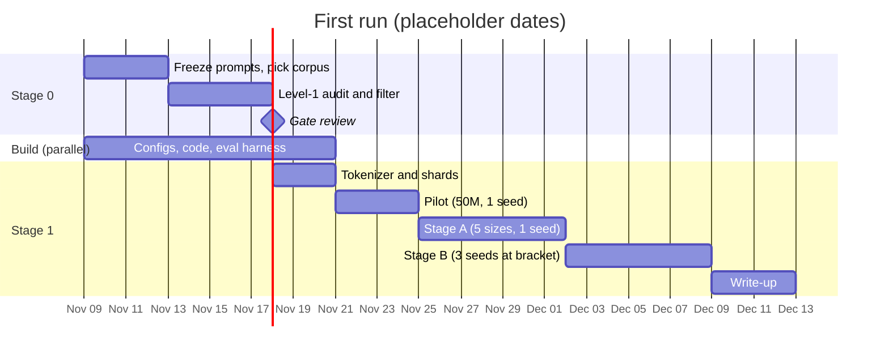

# Smallest reasoning-capable model under RL: experiment protocol (draft v5, minimum viable first run)

2026-11-02 · asked by arush

A draft protocol for finding N*, the smallest model size at which RL on a verifiable arithmetic task gives a reliable pass@1 gain, at Chinchilla-style token budgets.

This version scopes the first run down to the minimum that gives an answer. Everything else is kept in section L (Later), so the team can see the future paths without taking them on now. The protocol is a living document. Record every change in the changelog with its date. Items marked [done] are settled, [open] still need a decision, and [speculative] marks my own estimates. Dates are placeholders.

# Part 1: First run (minimum viable)

Goal: one answer to "what is N*?" as a bracket between two grid sizes, on one corpus and one task.

## 1. Question and hypothesis
- Question: at Chinchilla-optimal pretraining, what is the smallest size N* at which RL on the task gives a reliable pass@1 gain?
- Hypothesis (falsifiable): the verdict is monotone in size. If it is not, we report the flip pattern and N* is undefined.

## 2. Stage 0: data gate
- 0.1 Freeze the held-out eval puzzles, SFT prompts and RL prompts. Record their hashes.
- 0.2 Corpus: HuggingFaceTB/smollm-corpus, subset fineweb-edu-dedup (about 220B tokens). [open] Verify its license on the dataset card. Record the revision and subset.
- 0.3 Contamination audit, level 1 only: verbatim overlap between corpus and frozen prompt sets, using 13-gram hashes after normalization. Report counts and document IDs, never matched text.
- 0.4 Remove level-1 hits before shuffling and sharding. Re-run the check on the final stream.
- Gate: the final stream has zero level-1 hits, and the audit report (counts only) is committed.
- Not gating in part 1: template and arithmetic-density checks. See section L.

## 3. Parallel build (during Stage 0)
- Configs for the five grid sizes.
- Countdown generator, SFT trace generation, RL code and binary reward.
- Eval harness: pass@1 and pass@8 on at least 1,500 held-out puzzles.
- Verdict code: RL-minus-SFT gain with bootstrap CI.

## 4. Data (after the gate)
- Tokenizer: trained on the train split only. Vocabulary fixed across sizes. [open] Size, 8k to 16k for natural text.
- Dedupe: document-level, before sharding.
- Shuffle: one global shuffle with a logged seed.
- Nested shards: one tokenized stream. Model i reads the first T_i tokens. Shards are flat uint16 binaries, with an end-of-document token between documents.
- Token budget: T_i = 20 * N_i. For the largest grid point (500M), that is 10B tokens, which the corpus covers.
- Pilot check: shard i matches the first T_i tokens of the stream (checksum).

## 5. Model grid
- Architecture: dense decoder, pre-norm RMSNorm, RoPE, SwiGLU, grouped-query attention, tied embeddings. Fixed across sizes.
- Size: N = non-embedding parameters. Embedding size is fixed across the grid.
- Five sizes: 10M, 50M, 100M, 200M, 500M. [open] Confirm.
- Vary width at roughly fixed depth-to-width ratio (about 64 to 128), one knob at a time. [speculative] The ratio is a heuristic.
- Pretrain once per size. The SFT and RL seeds branch from that checkpoint. Only RL seeds vary in part 1. [speculative] This may understate pretraining variance, which is one reason for the later controls.

## 6. Task and pipeline
- Task: Countdown-style arithmetic, binary reward. SFT and RL data are generated separately from the corpus.
- SFT: synthetic reasoning traces from a fixed proposal policy, the same for all sizes.
- RL: GRPO, fixed step budget and learning-rate schedule, same prompts for all sizes. [open] Step count.
- Eval: pass@1 and pass@8 on at least 1,500 held-out puzzles, disjoint from SFT and RL data.

## 7. Verdict criterion (pre-register before any run) [open]
Reasoning is present at N if the RL-minus-SFT pass@1 gain is at least delta, with a 95% bootstrap CI excluding 0. Starting guess for delta: 2 points. The RL checkpoint must also be above the zero-reward floor on the B2 bin.

N* = the smallest grid size where the verdict is "present" and every larger size is also "present".

## 8. Search
- Stage A: all five sizes, 1 seed each. Mark the first flip.
- Stage B: 3 seeds at the two sizes bracketing the flip. Report the adjacent pair as the bracket for N*.
- If the verdict flips more than once, report the flip pattern and stop.

## 9. Pilot (first, before Stage A)
- One size (suggest 50M), one seed, end to end.
- The RL reward is not all zeros. If it is, the task is too hard at that size; make the curriculum easier before going on.
- Eval noise: re-run one checkpoint with a different eval seed.

## 10. What would change our minds
- The verdict flips more than once: monotonicity fails. Report the pattern.
- Gains are present at every size, including the smallest: the floor is below the grid. Extend downward in a follow-up.
- Gains are absent at every size: the task is too hard, not the model too small.

## 11. Limitations
- Countdown is not natural language. A small-model result does not transfer automatically to math or general reasoning.
- Five sizes and few seeds: the bracket is coarse.
- Level-1 audit catches verbatim overlap only, not paraphrase.
- The first answer is provisional until one control from section L is run.

## 12. Roles [open]
- Stage 0 owner: corpus, license, audit, filtering.
- Pilot and training owner: configs, shards, pretraining, SFT, RL.
- Eval and write-up owner: eval harness, verdict, bracket report.

Everyone reviews sections 7 and 8 before any run.

## 13. Timeline [placeholder]

## 14. Compute [speculative]
- Stage A is 5 RL runs. Stage B is about 6 more (3 seeds at 2 sizes). Total about 11 RL runs.
- The chess paper (arXiv:2607.16097) reports about 160 H200 GPU-hours for 2,000 RL steps at 50M. Larger sizes cost more. Expect a few thousand GPU-hours in total, to be confirmed by the pilot.

---

# Part 2: Later (not part of the first run)

These are kept as paths to follow once the first answer exists. Each one should be proposed and agreed on before it is started. Nothing here is required for part 1.

## L1. Audit extensions
- Level 2: task-template phrasing (e.g. "Using the numbers ... equal ..."). Report counts; set a threshold for action in a pilot.
- Level 3: arithmetic density (documents with many explicit equations). Review signal, not automatic removal.
- Paraphrase-level overlap, which n-gram matching misses.

## L2. Corpus and data controls
- Second corpus, e.g. DCLM-baseline-1.0 (card says research use only; check before use), at 2 to 3 sizes.
- Second shuffle seed at 2 to 3 sizes near the bracket.
- Second token budget (5 * N) to see how N* moves with data.
- Second test distribution (B4 only, or multiplication) to check that N* is not Countdown-specific.
- Check that branching seeds from one pretraining checkpoint does not understate variance.

## L3. Analysis
- Stage C: fit gain vs. log N across all runs, and report N* with fit uncertainty.
- Denser grid (8 sizes, e.g. adding 20M, 200M intervals, 1B) if the bracket is too coarse.
- Verdict sensitivity to delta.

## L4. Model variations
- Activation-shift arm from Peng, Zheng and Liu (arXiv:2610.14500, 2026). The shift subtracts a constant b inside the MLP. Because W2 trains, the shift is not a fixed bias that can be folded away in advance, so it must be implemented directly. How b is set for SwiGLU is undefined in the paper as I read it, so this arm is blocked until that is decided.
- Tokenizer size sweep.

## L5. Engineering extras (numerics-changing: choose once, apply to the whole grid, record in changelog)
- torch.compile or CUDA graphs. Small models are often launch-bound.
- Deterministic kernels, if affordable.
- Fused optimizer and norm kernels, checked once against the reference.
- FlashAttention, sequence packing, memory-mapped shards and checkpointing are already in part 1 as defaults. [open] Confirm.

## L6. Other paths
- Other RL algorithms (e.g. PPO-style), to see if N* depends on the algorithm.
- A natural-language task in place of Countdown.
- A from-scratch sweep below 10M, if the floor sits at the bottom of the grid.

## Changelog
- v5 (2026-11-02): reduced to a minimum viable first run (part 1). Everything else moved to part 2 (section L) as later paths. Grid cut to five sizes, Stage C and ablations deferred, level-1 audit only.
- v4 (2026-11-02): split into Stage 0 (data audit gate) and Stage 1 (experiment), with a parallel track; added timeline with placeholder dates; second corpus added to controls.
- v3 (2026-11-02): added engineering settings and the checkpoint-sharing proposal.
- v2 (2026-11-02): added data-side decisions (split, tokenizer, dedupe, nested shards, coverage), non-embedding N, and fixed token budget T = 20N.

## Sources
- Understanding Reasoning from Pretraining to Post-Training, arXiv:2607.16097 (2026). https://arxiv.org/abs/2607.16097
- Rethinking Activation Functions: Reducing Bias Can Improve Learning, Peng, Zheng and Liu, arXiv:2610.14500 (2026). https://arxiv.org/abs/2610.14500
- Scaling Behaviors of LLM RL Post-Training, arXiv:2509.25300 (2025). https://arxiv.org/abs/2509.25300
- A Technical Study into Small Reasoning Language Models, arXiv:2506.13404 (2025). https://arxiv.org/abs/2506.13404
- Small Models Struggle to Learn from Strong Reasoners, arXiv:2502.12143 (2025). https://arxiv.org/abs/2502.12143
- TinyZero, Jiayi Pan (2025). https://github.com/Jiayi-Pan/TinyZero
- Does Reinforcement Learning Really Incentivize Reasoning Capacity in LLMs Beyond the Base Model? (Yue et al., NeurIPS 2025). https://neurips.cc/virtual/2025/poster/119944
- Training Compute-Optimal Large Language Models (Hoffmann et al., NeurIPS 2022). https://proceedings.neurips.cc/paper/2022/file/c1e2faff6f588870935f114ebe04a3e5-Paper-Conference.pdf
- SmolLM-Corpus, HuggingFaceTB (Hugging Face dataset card). https://huggingface.co/datasets/HuggingFaceTB/smollm-corpus
- DCLM-baseline-1.0, mlfoundations (Hugging Face dataset card). https://huggingface.co/datasets/mlfoundations/dclm-baseline-1.0
